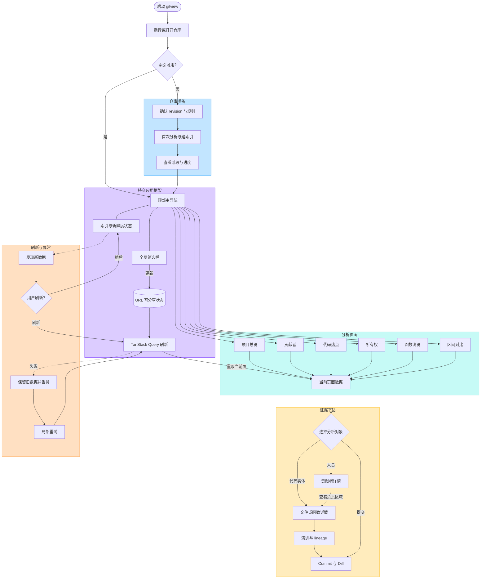

# 产品 UI 交互图

状态：草案
UI 主参考：本地 `agentsview` 项目
实现约束：React 19，不使用 Svelte；本文多数页面属于后续产品方向

首个 Web MVP 只实现单仓库 Overview、基础统计、按月趋势、贡献者列表和最近提交。本文中的 Hotspots、Ownership、Functions、Compare、三栏下钻、SSE 和高级筛选均不属于前期实现；增加第二个正式页面时再启用 `@tanstack/react-router` 的完整路由约束。

UI 交互、配色语义和视觉密度以本地 `agentsview` 为主参考；React 组件基座使用 [shadcn/ui](https://ui.shadcn.com/docs/components)，工程组织继续参考 `stella/web`。`agentsview` 使用 Svelte 5 和 `@kenn-io/kit-ui`，因此 gitview 不直接复制或导入其 Svelte 组件，而是用 shadcn/ui primitives 组合等价行为。

可编辑版本：[在 FigJam 打开 gitview 产品 UI 主交互图](https://www.figma.com/board/MxxPIiU93MAyS6Ff6DMghd)

早期使用过一次性本地原型比较三个布局方案；原型不属于正式源码，最终交互以 `frontend/` 实现为准。

## 0. agentsview 参考基线

实现 UI 前优先核对这些文件：

| 目标 | agentsview 参考 |
| --- | --- |
| 设计纪律与组件复用规则 | `DESIGN.md` |
| 全局主题、light/dark 与应用专用色 | `frontend/src/app.css` |
| 顶部导航与紧凑工具区 | `frontend/src/lib/components/layout/AppHeader.svelte` |
| 底部状态、新鲜度与进度 | `frontend/src/lib/components/layout/StatusBar.svelte` |
| Overview 页面密度与网格 | `frontend/src/lib/components/analytics/AnalyticsPage.svelte` |
| 指标摘要卡 | `frontend/src/lib/components/analytics/SummaryCards.svelte` |
| 可交互时间趋势 | `frontend/src/lib/components/analytics/ActivityTimeline.svelte` |
| 高密度表格 | `frontend/src/lib/components/activity/SessionsTable.svelte` |
| 筛选 chips | `frontend/src/lib/components/analytics/ActiveFilters.svelte` |

### 0.1 首版页面映射

```text
agentsview TopBar          → gitview 顶部仓库/HEAD 上下文
agentsview analytics page → gitview Overview
SummaryCards              → commits / contributors / additions / deletions / churn
ActivityTimeline          → 按月 commit/churn 趋势
SessionsTable             → Contributors 与 Recent commits 表格
StatusBar                 → HEAD、分析时区、数据新鲜度和 warnings
```

首版按需加入 shadcn/ui 的 `Button`、`Card`、`Table`、`Badge`、`Tooltip`、`Progress`、`Skeleton`、`Separator`、`ScrollArea` 和 `Alert`。应用层只组合 `AppShell`、`TopBar`、`StatusBar`、`SummaryCard`、`OverviewPanel` 和 `LoadingBar`；不重新实现 shadcn 已提供的 primitive。出现第二个真实使用点前，不扩展应用级通用 API。

shadcn/ui 组件源码进入 `frontend/src/components/ui/`，可按 gitview 的密度要求调整，但修改应保持在 primitive 内，不在每个 feature 页面复制相同 class。首个表格用 `Table` primitive；需要排序、筛选和分页后再引入官方 Data Table 组合。

### 0.2 配色与密度

- 使用 shadcn/ui 的 CSS variable 主题约定，并把 agentsview 语义映射为：页面背景 → `background`，surface/panel → `card`，主文字 → `foreground`，辅助文字 → `muted-foreground`，边框 → `border`，主要动作/选中 → `primary`，错误 → `destructive`。
- 在 shadcn 标准 tokens 之外只增加必要的 `success`、`warning` 与 `chart-*` tokens，分别承载 agentsview 的绿色、琥珀色和分类图表语义。
- 蓝色表达主要动作和选中状态，绿色表达成功/新鲜，琥珀色表达警告，红色只表达错误；不能用颜色作为唯一状态信号。
- 图表使用独立的 categorical series tokens，不把 contributor 身份色与成功/警告色混用。
- 同时提供 light/dark tokens；首个 MVP 可先跟随系统主题，不先做主题设置页。
- 沿用 agentsview 的紧凑尺度：工具栏 `8px 16px`、页面内容 `16px`、panel 内边距 `12px`、panel 间距 `12–16px`。
- 指标值约 `20px/600`，panel 标题约 `12px/600`，表格正文约 `11px`，辅助信息约 `10px`；数值列使用等宽字体并右对齐。
- 卡片和表格以细边框、低对比 surface 和 hover 层级区分，不使用大阴影、过度圆角或大面积渐变。

核心背景、文字和边框色由 gitview 的 shadcn CSS variables 定义；agentsview 只作为视觉校准基线。若复制 agentsview 或 `@kenn-io/kit-ui` 的具体 CSS/实现，编码前必须确认依赖许可证并保留必要声明。

### 0.3 交互继承

- 后台刷新保留旧内容，只降低轻微透明度并显示顶部细进度条，不用整页 loading 替换已有结果。
- error、empty、loading 按 panel 局部处理；失败提供就地 Retry。
- 表头固定，数值列可扫描，行 hover 明确；可导航行使用真实链接，保留浏览器打开新标签行为。
- 图表点/bar 支持 hover tooltip、点击下钻以及 Enter/Space 键盘操作。
- 控件优先使用 `frontend/src/components/ui/` 中的 shadcn/ui 组件，不新增一次性的原生 select 和局部 control chrome。
- 窄屏把双列内容收为单列；首个 Overview 不引入三栏和可拖动 sidebar。

## 1. 交互目标

gitview 参考 agentsview 的“本地优先、数据优先、高密度、持续可筛选、结果可下钻”体验，但把 session 分析对象替换为 Git repository、contributor、file、function 和 commit。

用户应能在一条连续路径中完成：

```text
打开仓库 → 看全局健康 → 缩小范围 → 找到异常 → 下钻实体 → 核对 commit 证据 → 返回且保留上下文
```

关键约束：

- 筛选、选中对象和比较窗口写入 URL，可刷新、分享、前进和后退。
- 导航到详情后保留日期、revision、path、language 和 identity mode。
- 每个综合指标都能下钻到构成项与 commit，不提供无法解释的“神秘分数”。
- 后台发现新数据时先提示，不强制刷新当前视图或打断阅读。
- 加载失败不清空已有内容；保留旧数据并标记 stale，允许局部重试。

## 2. 主交互图



### 图中关键含义

- “持久应用框架”始终存在，切换页面不会丢失仓库、revision 和全局筛选。
- “选择分析对象”不是统一弹窗，而是表格行、图表点、热力格或风险卡片的上下文动作。
- “证据下钻”优先使用带 URL 的详情页；轻量预览才使用右侧 inspector。
- 新数据事件只改变状态栏和提示条，用户决定何时刷新。
- 失败发生在局部 query；其他成功区域继续可用。

## 3. 桌面布局

参考 agentsview 的紧凑工作台和三栏详情布局：

```text
┌────────────────────────────────────────────────────────────────────┐
│ Repository ▾  Overview  Contributors  Hotspots  Ownership  Compare │
├────────────────────────────────────────────────────────────────────┤
│ Revision ▾  Date range ▾  Path ▾  Language ▾  Person ▾  Reset      │
│ Active filters: main ×  2026-01-01..2026-06-30 ×  Go ×             │
├────────────────────────────────────────────────────────────────────┤
│                                                                    │
│ 当前页面：摘要卡 / 趋势图 / 高密度表格 / 风险说明                  │
│                                                                    │
├────────────────────────────────────────────────────────────────────┤
│ Indexed HEAD abc123 · Updated 2m ago · 3 warnings · Refresh        │
└────────────────────────────────────────────────────────────────────┘
```

实体浏览采用可收起三栏：

```text
┌──────────────────┬────────────────────────────────┬─────────────────┐
│ 排名 / 文件树    │ 代码实体详情                   │ Inspector       │
│                  │                                │ 指标构成        │
│ 搜索与筛选       │ 趋势、贡献者、历史、lineage   │ 选中 commit     │
│                  │                                │ warnings        │
└──────────────────┴────────────────────────────────┴─────────────────┘
```

- 左栏承载集合导航，允许折叠。
- 中栏是主要阅读区域，拥有独立滚动。
- 右栏只展示当前选中项的辅助信息；可关闭，不替代正式详情 URL。
- 小屏设备把左右栏转换为 Sheet，主内容保持单列。

## 4. 全局导航

| 页面 | 首要回答 | 主要入口 | 主要下钻 |
| --- | --- | --- | --- |
| Overview | 项目最近发生了什么、风险在哪里 | 默认首页 | trend bucket、warning、top entity |
| Contributors | 谁在贡献、谁维护哪些区域 | 顶部导航 | person、path、commit |
| Hotspots | 哪些文件/函数最值得关注 | 顶部导航、Overview 卡片 | file/function、score basis |
| Ownership | 知识集中与无人维护区域在哪里 | 顶部导航、person 详情 | person、directory、entity |
| Functions | 某个函数如何演进、谁最熟悉 | 顶部导航、全局搜索 | function、lineage、commit |
| Compare | 两个窗口或 revision 有何变化 | 顶部导航、趋势选择 | changed entity、commit |

导航行为：

- 切换一级页面保留 `repoId`、revision、date、timezone 和适用于目标页的 filters。
- 页面私有 filters 不泄漏到其他页面，但返回时由 URL/history 恢复。
- 当前页面和筛选必须能从 URL 完整还原。
- Command Palette 可作为后续增强，用于跳转页面、仓库、贡献者和函数，不进入 P0。

## 5. 全局筛选栏

参考 agentsview 的 RangePicker、FilterDropdown 和 active filter chips。

从左到右建议：

1. Revision：branch/tag/commit，默认 HEAD。
2. Date Range：预设 7d、28d、90d、1y、All 与 Custom。
3. Period：day、week、month；只在趋势页面显示。
4. Path：目录或文件范围。
5. Language：单选或多选。
6. Identity：Person、Author、Committer。
7. More Filters：merge、bot、generated、vendor、confidence。
8. Reset：清除当前页面可清除项。

交互规则：

- 每个筛选变化立即写 URL；文本搜索使用短 debounce。
- filter chip 可单独删除，Reset 可恢复页面默认值。
- 日期范围跨页面保持一致，除非用户明确在 Compare 中启用双窗口。
- 无结果时保留筛选栏并展示“哪个条件导致收窄”，不能只显示空白图表。
- 筛选请求过程中保留旧内容并显示轻量 refreshing 状态，避免整页闪烁。

## 6. 页面交互细节

### 6.1 Overview

页面顺序遵循“结论 → 趋势 → 构成 → 证据”：

1. Summary cards：commits、contributors、additions、deletions、churn、hotspots。
2. Contribution timeline：点击某日/月进入带日期筛选的 Contributors 或 Commits 结果。
3. Contributor / language / directory breakdown：点击类别追加 filter。
4. Risk panels：ownership concentration、stale hotspot、complexity growth。
5. Top entities：点击进入文件/函数详情。

卡片必须展示对比基准，例如相较上一等长窗口，而不是只给绝对数字。

### 6.2 Contributors

- 顶部趋势和下方人员表使用同一 query scope。
- 表格默认列：person、commits、active days、additions、deletions、churn、owned entities、recent activity。
- 点击 person 打开正式详情 route；悬停或快捷动作可打开右侧 inspector。
- person 详情分为 Overview、Owned Areas、Functions、Commits 四个 tab，tab 写入 URL。
- 身份疑似重复时在 person 行显示 warning，可进入 Identity Resolution；P0 只读提示，配置编辑后置。

### 6.3 Hotspots

- 顶部使用 file/function segmented control。
- 图表提供 change frequency × complexity 视图；表格给出精确构成项。
- 点击热点进入实体详情，并保留当前 level、sort 和 filters 以便返回。
- 综合分数展开显示 frequency、size、complexity、ownership risk，不只显示 0–100。
- confidence 较低的函数 lineage 明确标记并支持查看断点。

### 6.4 Ownership

- 支持 directory tree、person matrix 和 risk list 三种视图，选中视图写入 URL。
- 选中目录后，中栏刷新贡献构成，右栏展示 historical owner、recent maintainer、last toucher。
- 点击 person 进入 person 详情；点击文件或函数进入实体详情。
- Bus factor 必须标注为 estimate，并允许展开阈值和权重模型。

### 6.5 Function Detail

- 页面头部：限定名、签名、路径、语言、当前复杂度、last changed、confidence。
- tabs：Overview、History、Contributors、Lineage、Source。
- History 中点击 commit，在右侧 inspector 预览 diff；“Open full diff”进入正式 commit route。
- Lineage 展示 rename/move 关系和置信度；unknown 不绘制为连续历史。
- Source 展示当前 revision 的只读代码，不能执行项目代码。

### 6.6 Compare

- 左右各选择 revision 或 date window；交换按钮互换 baseline 与 target。
- 先展示 totals delta，再展示 contributors、directories、files/functions 的变化。
- 点击 delta 行进入实体详情，并保留 baseline/target query params。
- 任一侧不可用时保留另一侧结果并解释原因。

## 7. 新鲜度与后台分析

参考 agentsview 的 SSE 策略：后台状态变化不主动重载完整报告。

| 状态 | UI 表现 | 用户动作 |
| --- | --- | --- |
| Fresh | 状态栏显示 revision 与更新时间 | 无 |
| Indexing | 状态栏显示阶段、完成数/总数、取消 | 可继续浏览旧结果 |
| New data | 顶部提示“发现新提交” | Refresh 或稍后 |
| Stale | 旧结果仍显示，附 stale 标记 | 重试或重新索引 |
| Partial failure | 失败 panel 内联错误，其他 panel 正常 | 局部 Retry |
| Fatal | 仓库不可读或 schema 不兼容 | Doctor / Rebuild 指引 |

SSE 事件只携带 job/progress/freshness 信号；大量报告数据仍通过 Query API 获取。

## 8. 加载、空状态与错误

- 首次加载：页面骨架与明确阶段文本。
- 后台刷新：保留旧数据，不替换为整页 skeleton。
- 空仓库：解释“仓库尚无 commit”，不显示错误。
- 筛选无结果：展示当前 active filters 和 Clear filters。
- 不支持语言：函数区域降级到文件级，保留其余报告。
- shallow clone：全局 warning，说明历史可能不完整。
- API 失败：panel 级错误和 Retry；错误信息直接、不道歉、不吞掉上下文。

## 9. 返回、分享和键盘

- 浏览器 Back 恢复列表滚动位置、排序、分页和筛选。
- 复制 URL 可复现当前仓库视图；本地 repo id 不暴露绝对路径时需使用稳定映射 ID。
- `Esc` 关闭 inspector / Sheet，不能清除页面筛选。
- `/` 聚焦当前列表搜索；`Cmd/Ctrl+K` 后期打开 Command Palette。
- `j/k` 可在高密度列表移动选择；Enter 打开详情。
- 所有快捷键必须有可见替代操作和帮助入口。

## 10. 完整产品交互验收（后续）

- 从 Overview 点击趋势点，可进入带相同日期、仓库和 revision 的结果页。
- 从 Contributor → Function → Commit 下钻后，Back 能逐层恢复上下文。
- 修改 URL search 后页面、Query key 和可见筛选保持一致。
- 刷新深层 Function URL 可恢复同一实体与 tab。
- 新 commit 到达时不打断阅读，用户确认 Refresh 后才更新报告。
- 一个 panel 请求失败不会清空其他成功数据。
- file/function 不支持或 confidence 低时有明确降级和 warning。
- 桌面三栏与移动 Sheet 均可完成相同下钻任务。
